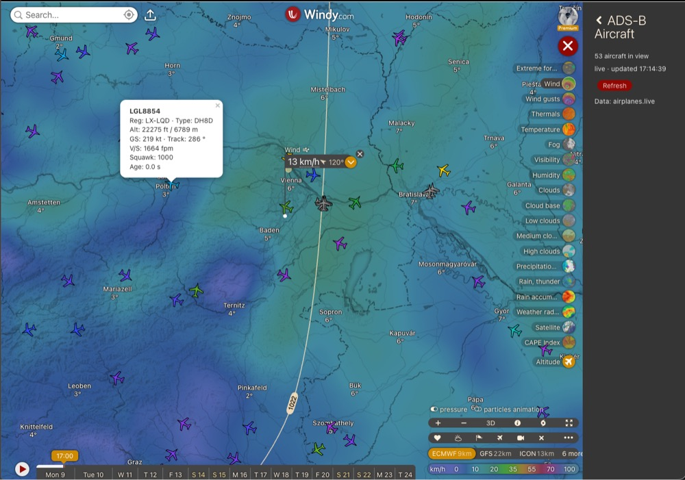

# 08 – ADS-B Aircraft

Shows live ADS-B aircraft over the visible map area. Data comes from [airplanes.live](https://airplanes.live/).



## Run

```sh
npm run example08
```

Then load `https://localhost:9999/example08/plugin.js` in [Windy developer mode](https://www.windy.com/developer-mode).

## Behaviour

The terms below (**Live Window**, **Paused**, **Cooldown**, **Refresh**) are defined in [CONTEXT.md](./CONTEXT.md).

- **Live Window**: opening the plugin, or pressing **Refresh**, starts a 10 s Live Window. During it the plugin polls every 2 s, and each poll uses the current map view.
- **Paused**: when the window ends, aircraft stay on the map, dimmed. The panel shows the time of the last data.
- **Cooldown**: if a poll fails, the Live Window ends and Refresh is disabled for 30 s, with a countdown.
- **Markers**: each aircraft icon is rotated to its track and coloured by barometric altitude:

  | ft     | 0      | 4 000  | 8 000 | 20 000 | 30 000 | 40 000 | ground |
  |--------|--------|--------|-------|--------|--------|--------|--------|
  | colour | orange | yellow | green | cyan   | blue   | purple | grey   |

  Clicking an aircraft opens a popup with callsign, registration, type, altitude (ft and m), ground speed, track, vertical rate, squawk and data age.
- **Query area**: the plugin queries a circle around the map centre whose radius reaches the view corner, capped at 250 nm. Aircraft outside the view are dropped. When the cap applies, the panel says so.

## API notes

- Endpoint: `https://api.airplanes.live/v2/point/{lat}/{lon}/{radius_nm}`. It needs no key, but use is non-commercial only.
- **Rate limit:** measured at about 15 requests per 30 s. Beyond that the API returns `429` with `retry-after: ~30`. The `429` carries no CORS header, so in the browser it shows up only as `TypeError: Failed to fetch`. This is why the plugin treats every failure as a rate limit.
- **Other sources:** adsb.lol and adsb.fi serve the same JSON format but send no CORS headers, so a browser cannot call them directly.
- **Origin:** the plugin was inspired by [ISmillex/adsb-flight-map](https://github.com/ISmillex/adsb-flight-map). The altitude colour ramp comes from there.

## Files

| File              | Purpose                                                       |
|-------------------|---------------------------------------------------------------|
| `plugin.svelte`   | Side panel, Live Window and Cooldown logic, marker updates by `hex` |
| `adsb.ts`         | API fetch, distance, colour ramp, icon, popup                 |
| `pluginConfig.ts` | Plugin metadata                                               |
| `CONTEXT.md`      | Glossary                                                      |
